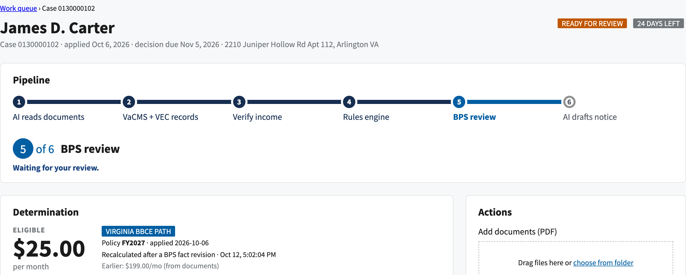
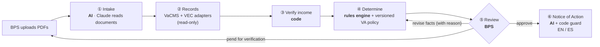
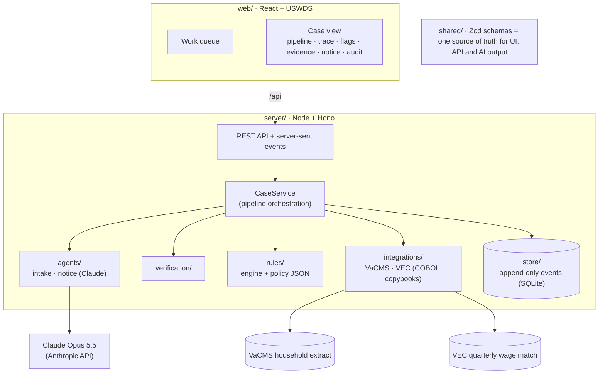
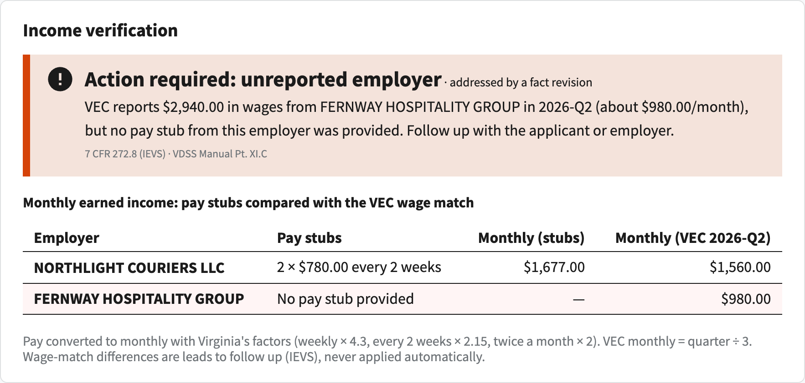
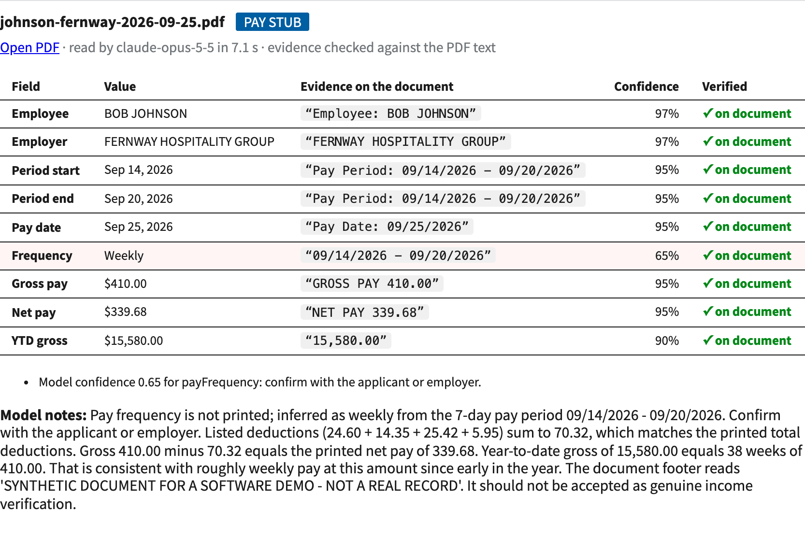
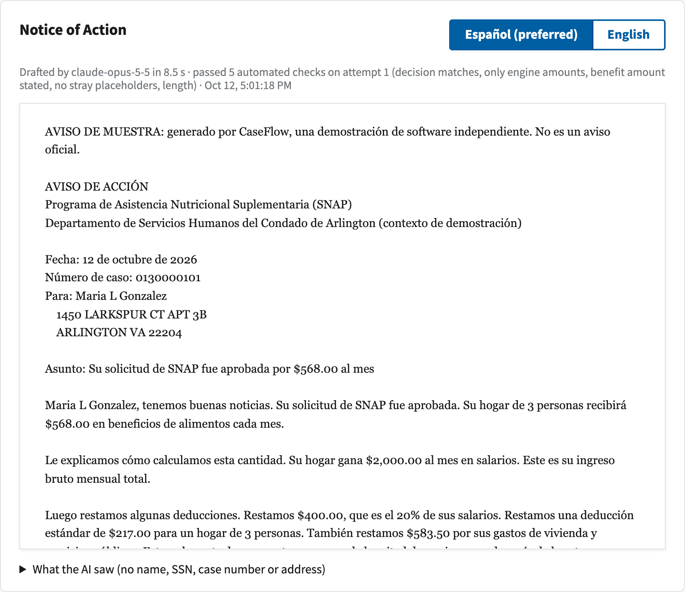
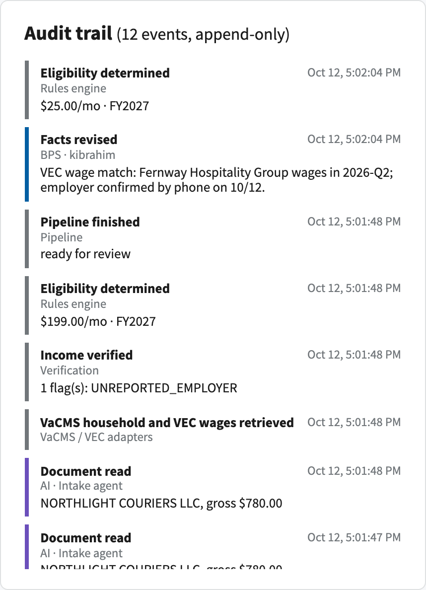
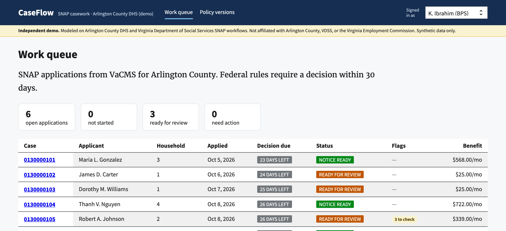

# CaseFlow

[](https://github.com/kenzyi2024/caseflow/actions/workflows/ci.yml)

**Human-in-the-loop AI for SNAP casework in Virginia.** AI reads the paperwork, deterministic code makes the eligibility decision, and a Benefit Programs Specialist approves it. Every step is cited, verified and recorded.

> [!IMPORTANT]
> **Independent demo.** Modeled on Arlington County DHS and Virginia Department of Social Services (VDSS) SNAP workflows. Not affiliated with or endorsed by Arlington County, VDSS, or the Virginia Employment Commission. All people, employers and documents are synthetic. Policy is simplified. Interface layouts are illustrative.



## Why

Federal rules require a decision on a SNAP application within **30 days**. Most of a caseworker's time goes into paperwork rather than judgment:

- reading pay stubs
- re-keying the numbers
- checking state wage records
- doing the eligibility arithmetic
- writing the decision letter

Agencies want that work to go faster. They also need every decision to stay **correct, explainable, appealable and auditable**, and owned by a person. CaseFlow is built around that tension.

## What it does

Take one of the demo cases: James Carter applies with two pay stubs.

1. **Claude reads the pay stubs.** It extracts each field with the exact quote it came from, and code confirms each quote is really on the PDF.
2. **The read-only adapters pull the records:** the VaCMS household, plus Carter's quarterly wages from the VEC wage match.
3. **Verification compares the two and finds a lead.** VEC shows wages from a second employer that Carter didn't report.
4. **The rules engine applies Virginia SNAP policy:** **$199/month**, with a line-by-line trace citing 7 CFR and the VDSS manual.
5. **The specialist follows up on the lead.** They click *"Count Fernway wages ($980/month)"* and record a reason. The engine recalculates: **$25/month**. Nobody types a benefit amount.
6. **The specialist approves.** Claude drafts the Notice of Action in English and Spanish from de-identified facts. Code checks every dollar amount, and fixed legal text adds the fair-hearing rights.

Every action, by the AI, the system or the specialist, is an immutable event in the audit trail.

## How it works



> **AI works at the edges, where unstructured information becomes structured and back again. Deterministic code makes the decision. A person approves it.**

| Step | Who | Why |
|---|---|---|
| Read documents → structured data | **AI** (Claude) | Unstructured input; where AI adds the most value |
| VaCMS household, VEC wages | Code (adapters) | Read-only integration behind one interface |
| Compare reported vs. recorded income | Code | Repeatable; wage-match results are leads, never auto-applied |
| Eligibility and benefit | Code (rules engine) | Correct, cited, appealable. **Never AI** |
| Approve, revise facts, pend | **Human** (BPS) | Accountability stays with a person |
| Decision letter | **AI**, then a code guard | Plain language and translation; code verifies every number |

### Architecture



**Stack:**
- TypeScript end to end (npm workspaces): React + Vite + USWDS, Node + Hono, Zod
- SQLite (better-sqlite3), the Anthropic SDK, pdf-lib + unpdf, Vitest

## Design decisions

Every significant choice is recorded as an Architecture Decision Record. Each one gives the options considered, the trade-offs, and a plain-language summary for non-technical stakeholders.

| ADR | Decision |
|---|---|
| [0001](docs/decisions/0001-typescript-end-to-end.md) | TypeScript end to end, with shared Zod schemas |
| [0002](docs/decisions/0002-code-controlled-pipeline.md) | Code-controlled pipeline; AI only at the unstructured edges |
| [0003](docs/decisions/0003-policy-as-versioned-data.md) | Virginia SNAP policy as versioned, effective-dated data |
| [0004](docs/decisions/0004-uswds-design-system.md) | U.S. Web Design System; real agency names for context only |
| [0005](docs/decisions/0005-append-only-event-log.md) | Append-only event log as CaseFlow's audit record |
| [0006](docs/decisions/0006-virginia-records-adapter.md) | Read-only adapter for VaCMS household and VEC wage records |
| [0007](docs/decisions/0007-pii-and-ai-guardrails.md) | PII minimization and guardrails around AI calls |
| [0008](docs/decisions/0008-bps-changes-facts-not-outcomes.md) | A BPS changes facts, not outcomes |

The full specification is in [docs/SPEC.md](docs/SPEC.md).

## AI guardrails

- **Bounded calls, not autonomous agents.** Each AI step is a single Claude call with schema-constrained output. Anything that doesn't match the schema is rejected.
- **Evidence is checked by code.** Every extracted field carries a verbatim quote. Code confirms the quote appears in the PDF's own text **and** shows the extracted value. This catches invented quotes, and also catches year-to-date pay read as this period's pay.
- **AI never decides eligibility.** Model updates cannot silently change outcomes.
- **De-identified notice generation.** The notice agent sees only amounts, household size and the decision. No name, SSN, case number or address. The exact input is stored with each notice (`factsSentToModel`) so it can be audited.
- **A guard on every letter.** The decision must match, every dollar amount must come from the rules engine, the benefit must be stated in both languages, and no stray placeholders are allowed. A failing draft gets one retry, then a person writes the notice.
- **Legal text is never AI-written.** Fair-hearing rights, the header and a "SAMPLE NOTICE" banner are fixed text inserted by code.
- **Fail safe.** Refusals, cut-off responses, API errors or low confidence route the case to manual review with the reason recorded. A run can never be left stuck in "processing."
- **Server-side fallback** is enabled on every model call. Each result records which model actually served it.

## Grounded in Virginia SNAP policy

- **Rules follow the VDSS SNAP Manual (Volume V).**
  - FY2026 values match Transmittal #36 exactly, and a test asserts it.
  - FY2027 uses the USDA cost-of-living update. Virginia's own figures for FY2027 are **provisional** until VDSS publishes them, and any determination that relies on them says so.
- **Broad-based categorical eligibility (BBCE):** gross income up to 200% of poverty; the resource and net-income tests don't apply (Manual Parts XI.A and IX.B). Above 200%, households fall back to the standard federal tests.
- **Statewide standard utility allowance** tiered by persons in the household ($375 for 1–3, $476 for 4+, FY2026). Pay is converted to monthly with Virginia's factors: weekly × 4.3, every two weeks × 2.15 (22VAC40-601-20).
- **Every trace line cites both** the federal regulation and the VDSS manual section, e.g. `7 CFR 273.9(d)(1) · VDSS Manual Pt. X.A.1`.
- **Context:** VaCMS has been the state's system of record since SNAP moved off the ADAPT mainframe in 2016–2017. CaseFlow reads from it and never writes to it.

## Screens

| | |
|---|---|
| **Verification:** pay stubs vs. VEC, with a cited lead<br/> | **Evidence:** every field quoted, verified, scored<br/> |
| **Notice of Action:** Spanish first for a Spanish-speaking household<br/> | **Audit trail:** AI (purple), system (gray), people (blue)<br/> |



## Getting started

Requirements:
- Node.js 22+
- an [Anthropic API key](https://console.anthropic.com/). Only the live AI steps need it; the tests run offline.

```bash
npm install
cp .env.example .env        # then add ANTHROPIC_API_KEY
npm run demo:reset          # builds a realistic queue with the real AI (~$0.25), or: npm run demo:reset -- --offline
npm run dev                 # API on :8787, UI on http://localhost:5173
```

| Script | What it does |
|---|---|
| `npm run dev` | API and UI with live reload |
| `npm test` | 100 automated tests (offline; no API key, no cost) |
| `npm run typecheck` | Type-check shared, server and web |
| `npm run eval` | Intake eval against the real model on 11 synthetic documents |
| `npm run seed` | Regenerate synthetic VaCMS/VEC files and pay stub PDFs from the scenarios |
| `npm run demo:reset` | Rebuild the demo database (stop the server first) |
| `npm run check:api -w server` | Confirm the API key works (never prints it) |

## Testing and evaluation

**Automated tests (Vitest, 100 tests, offline):**
- the rules engine, against hand-calculated benefits
- the copybook and fixed-width parsers
- the VaCMS and VEC adapters
- every intake and notice guardrail
- verification rules
- pipeline failure modes
- event-log tamper resistance (database triggers)
- the HTTP API end to end

AI steps are exercised through deterministic fakes built from the answer key.

**CI** (GitHub Actions) runs on every push:
- type-check
- tests
- a fixture-drift check: synthetic data must regenerate byte-for-byte
- the production web build

**Intake eval** (`npm run eval`): the real model on 10 pay stubs in two employer layouts, one of which omits the pay frequency, plus a utility bill:

| Metric | Result (Claude Opus 5.5, effort `low`) |
|---|---|
| Documents fully correct | 11 / 11 |
| Field accuracy | 90 / 90 |
| Evidence quotes verified on the PDF | 100% |
| Inferred pay frequency flagged for confirmation | 2 / 2 |
| Median latency · cost per run | ~8 s · ~$0.35 |

## Project structure

```
caseflow/
├── docs/                 SPEC.md, decisions/ (ADRs), images/
├── shared/src/           Zod schemas and types shared by UI, API and AI outputs
├── server/
│   ├── src/agents/       intake + notice agents, guards, fixed notice text
│   ├── src/integrations/ copybook reader, fixed-width parser, VaCMS + VEC adapters
│   ├── src/verification/ income verification, name matching
│   ├── src/rules/        rules engine, income conversion, policy JSON (FY2026, FY2027)
│   ├── src/pipeline/     CaseService orchestration, event projection
│   ├── src/store/        append-only SQLite event store
│   ├── src/api/          Hono REST API + server-sent events
│   ├── data/             synthetic VaCMS/VEC files, pay stub PDFs, eval answer key
│   ├── fixtures/         scenarios (single source of truth), PDF renderer, offline fakes
│   └── test/             Vitest suites
├── web/src/              React + USWDS: pages, panels, API client, live updates
└── evals/                intake eval harness
```

## Limits and what production would need

- **Synthetic data and illustrative interfaces.** The VaCMS and VEC record layouts are modeled, not the real (non-public) specifications.
- **Simplified policy.** Not modeled: medical, dependent care and child support deductions; shared-residence utility proration; work requirements; expedited service. See [SPEC §8](docs/SPEC.md#8-virginia-policy-scope-deliberate-simplifications).
- **Before real use:**
  - agency single sign-on and role-based access
  - hosting inside an authorized government cloud boundary
  - PostgreSQL in place of SQLite
  - observability and monitoring
  - a formal Section 508 audit
  - review of policy values and notice text by VDSS policy and legal staff
  - official interface control documents from VDSS and VEC

## How this was built

I wrote the specification, chose the architecture and made the design decisions recorded in [docs/decisions](docs/decisions/README.md). I used Claude Code as a pair programmer for much of the implementation, and the commits are co-authored accordingly. My job was to specify, review and verify.
